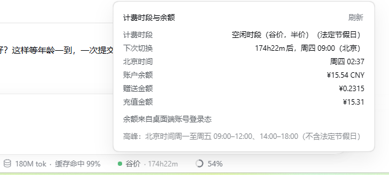

# dsh-tide-badge（修改版）

> **这是 [xiangrikuibaize/dsh-tide-badge](https://github.com/xiangrikuibaize/dsh-tide-badge) v0.2.3 的非官方修改版，不是 npm 上的 `dsh-tide-badge`。**
>
> 改动只有一个主题：把「本次对话花费」从**余额差值法**换成**按会话 token 用量 × 官方价目表**（方案 A），
> 修掉"账户级余额被记到单个对话头上"的串账问题。峰谷、节假日、余额取数那部分逻辑与上游一致。
>
> | | |
> |---|---|
> | 基于上游 | [`xiangrikuibaize/dsh-tide-badge`](https://github.com/xiangrikuibaize/dsh-tide-badge) **v0.2.3**（本仓库第一个 commit 是它的原样导入，可 `git diff v0.2.3..v0.3.0` 逐行看改动） |
> | 本仓库版本 | **0.3.1** |
> | 包名 | 仍是 `dsh-tide-badge`（同名可直接替换上游版本） |
> | 许可 | MIT，版权归原项目与贡献者；修改部分同样以 MIT 发布 |
> | 差异说明 | [CHANGELOG.md](CHANGELOG.md) |
>
> 上游为什么需要改：余额是**账户级**读数，而旧版拿它推导**对话级**数字，且每个对话各有一份
> "上次读数"基准 —— 同一笔扣费会被多个对话各记一遍。本机实测 8 个对话「本次」合计 ¥17.22，
> 而账户实际只掉了 ¥5.25，单个对话偏差从"漏记成 ¥0"到 **142 倍**。

DSH 输入框下方的**计费时段与余额**药丸：显示当前是**峰价**还是**谷价**、距离下次切换还有多久、账户余额多少，以及**这个对话本身花了多少钱**。

点开面板可看完整读数、逐桶用量与价目表。



## 安装

> ⚠️ `dsh plugin add dsh-tide-badge` / 插件市场里搜到的 `dsh-tide-badge` 是 **npm 上的上游原版（0.2.3）**，
> 不含本仓库的修复。要装这个修改版，请从本仓库目录安装。

```bash
git clone https://github.com/errolleefin/dsh-tide-badge.git
dsh plugin --profile <你的 profile，如 desktop> add ./dsh-tide-badge
```

装好后**重启 DSH**（宿主会缓存客户端 bundle）。药丸出现在输入框下方、原生「缓存命中」那一排的后面。

- 与上游**同包名**：装上本仓库版本会替换掉 npm 版本；之后再 `add dsh-tide-badge` 会退回上游原版。
- 不想用 `git clone` 的话，把仓库目录下载下来，用插件管理器的本地目录安装同样可以。

> 需要 DSH ≥ 0.1.0-rc.5 与 Node ≥ 20。「本次花费」依赖 DSH 的 `tokenUsage` 会话投影（0.2.x 起自带）；投影不可用时只显示余额与时段。

## 与上游 v0.2.3 的差异

| 环节 | 上游 0.2.3 | 本仓库 0.3.x |
|---|---|---|
| 「本次」的数据源 | 两次余额读数之差（账户级） | `tokenUsage` 会话投影的四桶累计用量 |
| 归属 | 嗅探"前台会话"，切回旧会话即结算整段间隔 | 由 `sessionId` 决定，账本按会话分行 |
| 计价 | 不计价，直接拿钱包下降额 | `Σ(每桶增量 × 当时峰/谷单价)`，价目表单点维护 |
| 无会话 id | 落到共用 `"default"` 一行（同一笔钱可被记多遍） | **不记账**（宁可不显示） |
| 币种 | 用余额币种格式化累计值 | 固定人民币（价目表就是人民币） |
| 面板 | 时段 / 倒计时 / 余额 | 增加「本次花费」+ 未命中 / 缓存命中 / 缓存写入 / 输出四行用量，脚注两行：当前档位单价、档位与口径 |
| 子代理 | 未说明 | 脚注写明"不含子代理会话" |
| `anySessionRunning()` | 读 `snap.sessions`（新版 DSH 恒为空 → 保护失效） | 读 `snap.byId[id].running` |

新增文件：`lib/pricing.mjs`、`lib/pricing.test.mjs`、`tools/client-smoke.mjs`、`tools/session-cost.mjs`、`CHANGELOG.md`。
修改文件：`client.template.js`、`lib/build.mjs`、`lib/client.js`（构建产物）、`package.json`、`README.md`。

**相对上游没有改的**：峰谷/节假日判定（`season.mjs`、`holidays.mjs`）、余额取数（账号路优先 + 重试）、路由与 bundle 组装。

## 从上游同步

```bash
git remote add upstream https://github.com/xiangrikuibaize/dsh-tide-badge.git
git fetch upstream --tags
git log --oneline v0.2.3..upstream/main   # 看看上游之后改了什么
```

## 它做什么

- **峰价 / 谷价**（按官方规则，含中国法定节假日与周末）
- **切换倒计时**，每秒本地推进
- **账户余额**：桌面端账号登录态优先，`DEEPSEEK_API_KEY` 兜底
- **本次对话花费**：按本会话的 token 用量 × 官方价目表估算，按对话隔离，不串账

融合了两个插件的长处：

| 来源 | 采纳的部分 |
|---|---|
| [`dsh-billing-badge`](https://github.com/devacc8/dsh-billing-badge)（MIT） | UI 形态：挂在原生统计行（"缓存命中"那一排）的小药丸、点击展开的面板与布局、原生样式变量 |
| [`dsh-whale-widget`](https://github.com/MeteorNOX/DeepSeek-Balance-Whale-Widget)（MIT） | 余额取数（桌面端账号登录态优先、API Key 兜底）与**中国法定节假日**适配、峰谷生效分界线 |

两者的代码均为 MIT 许可，本项目在其基础上重写与合并；峰谷与节假日逻辑按官方计费规则重新实现并加了单元测试。感谢两位作者。

## 显示位置

输入框下方统计行里、紧跟原生"**缓存命中**"药丸之后的一枚小圆点药丸：

```
● ¥8.22 · 本次 ¥0.31 · 谷价 · 82h01m
  ↑账户余额   ↑本次对话花费   ↑档位  ↑距下次切换
```

- **账户余额**与**本次对话花费**都常显在药丸上，不必点开。（花费为淡色，余额为主色。）
- **峰价 · 2h13m** / **谷价 · 45m**，圆点颜色：峰价橙色、谷价绿色
- 点击展开面板：计费时段（含"法定节假日"/"周末"标记）、下次切换、北京时间、**本次花费与逐桶用量**、账户余额（余额/赠送/充值明细）、当前档位单价与口径
- 面板脚注只列**当前档位**的三个单价（谷价时是 `未命中 1 · 缓存命中 0.02 · 输出 4`），换档即整行替换，不再给"谷→峰"区间

## 本次对话花费怎么算（0.3.0 起）

0.2.x 用**余额差值**记账：拿两次余额读数之差当作这段时间的花费，记到"当时在前台的那个对话"头上。但余额是**账户级**度量 —— 同一账号的其他对话、其他 API Key、手机 App 都扣同一个钱包，而采样点只有前台对话。结果是双向错账：本机实测 8 个对话「本次」合计 ¥17.22，账户实际只掉了 ¥5.25，单个对话偏差从"漏记成 ¥0"到 **142 倍**；同一段余额下降还会被多个对话各记一遍（详见 [issue-tide-badge.md](https://github.com/xiangrikuibaize/dsh-tide-badge/issues)）。

0.3.0 改成**方案 A**：

```
本次花费 = Σ(本会话每个用量桶的增量 × 观察时刻档位的单价)
```

- 数据来自 DSH 自带的 `tokenUsage` **会话投影**（`uncachedInputTokens` / `cacheReadTokens` / `cacheWriteTokens` / `outputTokens`，来自 provider 每次响应自报的 usage，按会话累计；原生「缓存命中」药丸读的也是它）。
- **归属由 sessionId 决定**：别的对话、别的 API Key、手机 App 的消耗进不来；本会话的消耗也不会被记到别处。同一笔钱被记多遍在结构上不可能。
- 投影是**累计值**，所以每次拿到新值先与账本里的上一份快照逐桶做差，再按**当时的**峰/谷档位计价累加。跨 09:00 / 12:00 / 14:00 / 18:00 边界的单轮按观察时刻计价，最多错一轮，方向可预期。
- 账本按 sessionId 分行存在浏览器 `localStorage`（键 `dsh-tide-badge/session-cost/v2`），刷新/重启不丢；旧差值法账本（`…/session-cost`）在升级时清掉。
- **首次见到某个会话**（没有账本行）时，把它的累计用量整体按当前档位计价：「本次」= 这个对话到目前为止的花费。代价是重开旧会话时，它的历史轮次按此刻的档位估算（最坏差 2 倍，只会发生在恰好横跨峰谷的旧会话上）。
- 取不到会话 id 时**不记账**，绝不退回一条共用的 `"default"` 账。
- **不含子代理会话**：子代理是独立 session，有各自的用量；面板脚注里写明了这一点。
- 余额仍然照常取、照常显示，但只代表**账户余额**，不再参与「本次」。

### 价目表

`lib/pricing.mjs` 是唯一的「钱」定义（元 / 百万 token）：

| 桶 | 谷价 | 峰价 |
|---|---|---|
| 缓存命中输入 | 0.02 | 0.04 |
| 缓存未命中输入 | 1 | 2 |
| 缓存写入（DeepSeek 不单列，按未命中兜底） | 1 | 2 |
| 输出 | 4 | 8 |

峰价为谷价的两倍。金额以 `1e8` 为单位的整数累加，单 token 单价恰好是整数（0.02 元/M ↔ 2 单位），所以除每笔增量取整外没有浮点误差。

改价只需改 `PRICE_PER_MILLION` 一处；`build.mjs` 会把它和 `season.mjs` 一起内联进客户端。

### 怎么验证这个数字

`tools/session-cost.mjs` 用会话日志复算同一口径：解析 `~/.dsh/sessions/**/session.v4.jsonl.zstd` 里每条 `assistant/message` 的 provider usage，按消息时间判峰谷累加，输出每个会话的 token 与金额。本机实测与 issue 表格逐行吻合（会话 A 62 轮 = ¥0.2921），单元测试里也钉住了这一行。

```bash
node tools/session-cost.mjs          # 花费最高的 12 个会话
node tools/session-cost.mjs --all    # 全部
```

### 余额刷新的节奏

自动刷新每 5 秒检查一次，以下任一成立就直接跳过、不发起取数：

| 条件 | 含义 |
|---|---|
| 芯片未挂载 | 没地方显示，没必要请求 |
| 页面在后台 | `document.hidden` |
| 60 秒内有动静 | `[data-conversation-scroll]` 的 DOM 变动会重置计时 |
| 有会话在跑 | 会话快照 `byId[id].running` 为真（0.3.0 修正了旧实现读 `snap.sessions` 恒为空、保护失效的问题） |

所以模型思考期间不会刷新余额；这只影响余额数字的新鲜度，**不再影响「本次」**——花费由投影驱动，随时更新。

## 计费规则（判定依据）

官方 [模型 & 价格](https://api-docs.deepseek.com/zh-cn/quick_start/pricing) 脚注 (2)：

> 北京时间**周一至周五（不含中国法定节假日）9:00–12:00、14:00–18:00** 为高峰时段；
> 其余时段，包括**周末及中国法定节假日全天**均为空闲时段。
> 空闲时段价格为高峰时段价格的一半。

历史回放按当时规则计价，因此带生效分界线：

| 规则 | 生效时刻（北京） |
|---|---|
| 峰谷定价实施 | 2026-08-17 00:00 |
| 周末全天谷价 | 2026-08-23 00:00 |
| 法定节假日全天谷价 | 2026-09-19 00:00 |

## 余额从哪来

两条路，**账号优先**：

1. **桌面端账号登录态** —— 走 DSH 自己的 `deepseekAccount` 服务。官方 `/user/balance` 只认 `sk-` 开头的 API Key，而桌面端登录用的是 OAuth 授权，所以登录用户必须走这条路。面板底部会注明"余额来自桌面端账号登录态"。
2. **API Key** —— `DEEPSEEK_API_KEY`（DSH 凭据或环境变量）→ `GET /user/balance`。账号路不可用时才走，作为兜底。

**失败时不留白。** 两条路互不通气时，面板底部会把各自的原因分别摊开（`账号路：…；API Key 路：…`），而不是笼统一句"未配置"。账号路区分这些情况：服务不存在 / 未登录 / 平台查询失败（登录态可能过期）/ 没有余额钱包 / 钱包数据无法解析。

> 为什么账号优先：若凭据里残留一个**无效**的 API Key，密钥路的失败会掩盖本该成功的账号路（本机就踩过：一个 32 位十六进制串导致长期 401）。

API Key 不出宿主进程，浏览器只拿到余额数字。失败一律降级成面板上一行文案，不抛出。

### 为什么账号路带重试

余额查询打的是 `platform.deepseek.com`，而**推理**打的是 `api.deepseek.com` ——两个域，两条网络路径。装了会做 HTTPS 解密的杀软（如 Kaspersky）时，`platform` 域会**间歇性** TLS 失败：解密连接插入自签根证书，Node 的 undici 只认自带 CA 列表、不读 Windows 证书库，于是报 `SELF_SIGNED_CERT_IN_CHAIN`。

本机实测约 **3/8 概率失败**，且是随机的 —— 所以 `readAccountBalance` 带 3 次重试，单次失败不影响最终结果。

若要根治，可让 Node 信任杀软根证书（会信任链多一环，属常规权衡）：

```powershell
# 1) 导出根证书为 PEM，2) 指向它
[Environment]::SetEnvironmentVariable('NODE_EXTRA_CA_CERTS', '<根证书.pem 的绝对路径>', 'User')
```

设置后重启 DSH。本机实测该方案 8/8 成功。

## ⚠️ 年度维护：节假日表

`lib/holidays.mjs` 是**唯一需要每年更新**的文件。国务院办公厅通常每年 11 月发布次年安排，届时补录 `HOLIDAY_VALLEY`。

**只列放假的日期**：调休上班日全部落在周末，按"周末也是谷价"的规则本就是谷价，无需单列。

漏录不会报错，只会**静默地**把工作日假期误判成峰价（多算钱）。插件启动时会自检并在日志里提醒缺少哪一年。

当前覆盖：**2026 年**。

## 架构

```
lib/
  holidays.mjs        节假日表 + 三条生效分界线（年度维护点）
  season.mjs          峰谷判定、下一次切换、文案与颜色（两端共用）
  season.test.mjs     峰谷/节假日单元测试（29 项）
  pricing.mjs         价目表 + 逐桶计价 + 账本推进规则（唯一「钱」定义）
  pricing.test.mjs    价目表与记账规则单元测试（22 项）
  index.js            宿主半边：/plugins/tide-badge/state 只读路由
  build.mjs           把 season/holidays/pricing 内联进客户端
  client.js           由 build.mjs 生成，勿手改
client.template.js    客户端模板
cordis.patch.yml      bundle 组装补丁
tools/
  client-smoke.mjs    无头跑真实 client.js：挂载、切会话、记账、面板（9 项）
  session-cost.mjs    用会话日志复算每会话花费（对账用）
```

**两端同源**：浏览器半边是由宿主注入的普通脚本，其 `require` 不认识相对路径 import，所以 `build.mjs` 把 `season.mjs`、`holidays.mjs` 与 `pricing.mjs` 内联进 `client.js`。节假日清单也由宿主通过路由下发，前端用同一份源码复算 —— 保证两端算出的切换点完全一致。

### 数据流

```
宿主 GET /plugins/tide-badge/state ──► 时段/倒计时/余额 ──┐
                                                        ├─► 药丸（DOM，每秒 tick）
客户端 useProjection("tokenUsage") ──► 四桶累计用量 ─────┘     └─► 面板
                                        │
                                        └─► localStorage 账本（按 sessionId 分行）
```

## 开发

```bash
npm run build       # 改完 season/holidays/pricing 后重新内联客户端
npm test            # 峰谷 + 价目表单元测试（51 项）
npm run test:client # 无头跑真实 client.js（挂载/切会话/记账/面板，9 项）
npm run check       # build + 语法校验 + 全部测试
```

改完需**重启 DSH** 才生效：宿主半边在启动时装配，客户端 bundle 也由宿主在启动时读入并缓存，刷新页面拿到的仍是旧版本。

`_upstream-0.2.3/` 是改造前的上游源码快照，方便 diff；发布包（`files`）不包含它。
